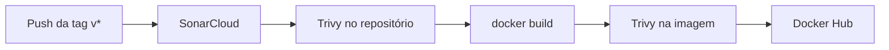

# Sistema financeiro reengenheirado

Processador de vendas separado por responsabilidades, com o padrão **Strategy** para frete e imposto. A esteira de CI/CD no GitHub Actions é o controle que impede regressão de qualidade e de segurança: ela só roda em tags `v*` e só publica a imagem no Docker Hub se o SonarCloud e o Trivy passarem.

O comportamento de referência é o do processador legado: documento com 11 caracteres, imposto de 15% acima de R$ 100 e 5% até esse limite, frete grátis para VIP, R$ 15 para cliente comum em SP/RJ/MG e R$ 50 nos demais casos.

## Arquitetura

| Pacote | Responsabilidade |
| --- | --- |
| `dominio` | Cliente, pedido, item, recibo e regras de negócio |
| `estrategia` | Algoritmos intercambiáveis de frete e de imposto (GoF Strategy) |
| `servico` | Validação do documento, orquestração e formatação do recibo |

`ProcessadorDeVendas` não decide alíquota nem frete. `SeletorEstrategiaFrete` escolhe `FreteIsento`, `FretePorRegiao` ou `FreteFixo`. `CalculadoraImposto` escolhe `ImpostoProdutoCaro` ou `ImpostoProdutoAcessivel`.

## Executar localmente

Requisito: JDK 21.

```bash
./mvnw verify
./mvnw -DskipTests package
java -jar target/sistema-reengenheirado.jar
```

No Windows, use `mvnw.cmd` no lugar de `./mvnw`.

```bash
docker build -t sistema-reengenheirado .
docker run --rm sistema-reengenheirado
```

O recibo do cenário de referência (João Silva, cliente comum em SP) fecha em **R$ 387,00**.

## Esteira



Arquivo: [`.github/workflows/ci-cd.yml`](.github/workflows/ci-cd.yml).

Um commit na branch `main` não dispara o pipeline. Só isto dispara:

```bash
git tag v1.0.0
git push origin v1.0.0
```

O job `Build e Push para Docker Hub` declara `needs: analise_codigo_e_seguranca`. Se o Quality Gate do Sonar falhar, ou se o Trivy encontrar vulnerabilidade CRITICAL ou HIGH com correção disponível, a imagem não é publicada.

A action `sonarsource/sonarcloud-github-action` do enunciado foi arquivada em 22/10/2025. O workflow usa `SonarSource/sonarqube-scan-action@v8.1.0`, que é a substituta oficial. As actions de terceiros estão fixadas em versão, sem `@master`.

## Configurar o SonarCloud

1. Crie uma conta em [sonarcloud.io](https://sonarcloud.io) com o GitHub.
2. Importe o repositório **público** (o plano gratuito cobre repositórios públicos).
3. Em *Administration → Analysis Method*, desligue a *Automatic Analysis*. A análise tem de ser a deste workflow, senão as duas entram em conflito.
4. Anote a **Organization key** e a **Project key** mostradas no tutorial.
5. Gere um token em *My Account → Security*.
6. No GitHub, em *Settings → Secrets and variables → Actions*:

| Tipo | Nome | Valor |
| --- | --- | --- |
| Secret | `SONAR_TOKEN` | token do SonarCloud |
| Secret | `DOCKER_USERNAME` | usuário do Docker Hub, em minúsculas |
| Secret | `DOCKER_PASSWORD` | access token do Docker Hub, não a senha da conta |
| Variable | `SONAR_ORGANIZATION` | organization key |
| Variable | `SONAR_PROJECT_KEY` | project key |

No Docker Hub, crie um Access Token em *Account Settings → Security* e use-o como `DOCKER_PASSWORD`. O repositório `sistema-reengenheirado` pode ser criado no primeiro push; a visibilidade pública configura-se no Docker Hub.

## Onde estão as evidências

**SonarCloud.** No projeto, o cartão *Quality Gate* mostra *Passed* ou *Failed*. Code Smells e Duplications aparecem no overview. A complexidade ciclomática está em *Measures → Complexity → Complexity* (a métrica *Complexity* do Sonar é a complexidade ciclomática; *Cognitive Complexity* é outra medida).

**Trivy.** No GitHub, abra *Actions → a execução da tag → o step do Trivy*. A tabela fica no log. O step *Trivy na imagem Docker* é o que inspeciona a imagem base (JDK e Alpine). O step *Rodar Trivy Vulnerability Scanner* inspeciona o código e o `pom.xml`.

**Docker Hub.** `https://hub.docker.com/r/<usuario>/sistema-reengenheirado/tags`, com a tag `v1.0.0`.

O texto para o PDF está em [`RELATORIO.md`](RELATORIO.md).
